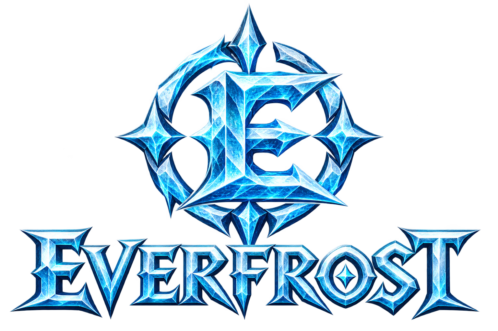
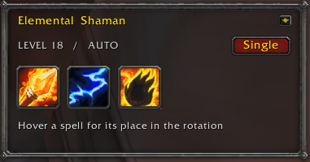
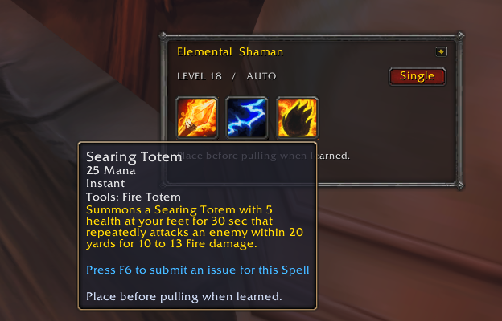
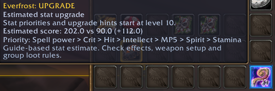
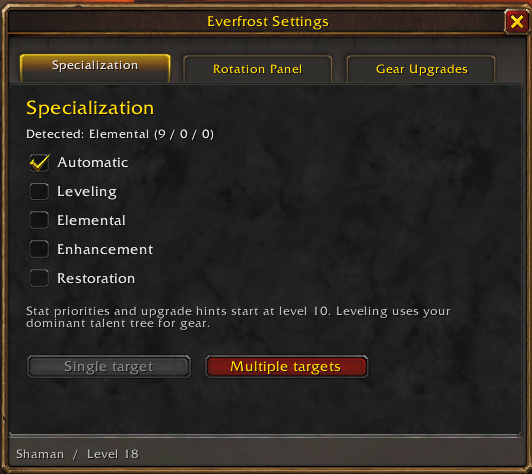
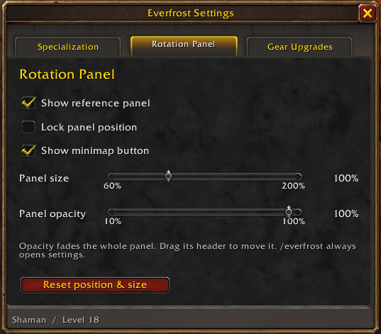
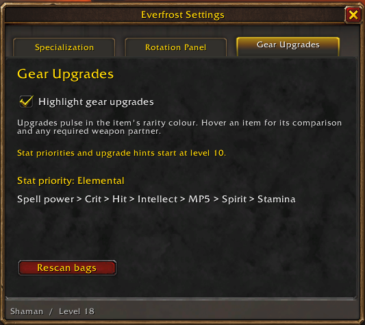

# Everfrost — Spell Rotation & Gear Upgrade Guidance

<p align="center">
  
</p>

**Find your class rhythm. Forever.**

Everfrost is a lightweight, standalone Lua addon for **WoW Forever**. It displays a compact, class-aware ability reference for **levels 1–30**, with profiles for all **nine classes and 27 talent trees**. Recommendations are informed by Icy Veins Forever guides and filtered against the spells your character has actually learned. Guide-based gear comparisons add a shiny border to estimated bag upgrades and highlight Need or Greed on the standard loot-roll window.

**Built with new players in mind.** Everfrost grew out of playing alongside brand-new players and people trying WoW for the first time. Its guides focus on **basic rotations and gear stat priorities** for your class and spec, giving you a simple starting point while you learn. The aim is to keep the basics visible and make early decisions about abilities and gear easier to understand.

**Written with OpenAI Codex.** The project uses Codex for AI-assisted development, review, and documentation. Automated validation uses a simulated client. Early in-game checks confirmed the gear eligibility fix, rarity pulse and settings layout; the latest talent fix and broader client compatibility still need verification.

[CurseForge](https://www.curseforge.com/wow/addons/everfrost) · [Download v0.6.1](https://github.com/mckenna654/Everfrost/releases/tag/v0.6.1) · [Report an issue](https://github.com/mckenna654/Everfrost/issues) · [Guide sources](addon/Everfrost/SOURCES.md)

CurseForge targets WoW Forever **1.60.1**. Third-party addon-manager distribution is enabled. New version tags trigger automatic packaging; file processing and moderation can delay availability.

## Project status

| Item | Current status |
| --- | --- |
| Addon version | **0.6.1** |
| Supported levels | **1–30** |
| Class coverage | Nine classes, 27 talent trees, and nine general leveling profiles |
| Target interface | `16001` — compatibility with the actual Forever client remains unverified |
| Runtime | Lua 5.1-compatible syntax; no third-party addon libraries required |
| Validation | Lua syntax checks and mocked-client regression tests |
| In-game verification | Selected gear/glow/settings behavior confirmed by user; latest talent fix and broader compatibility outstanding |

Everfrost is an independent project. It is not an official Icy Veins, Blizzard, or OpenAI addon and is not affiliated with or endorsed by those organizations.

## Screenshots

Captured in WoW Forever on a level-18 Elemental Shaman.

| Rotation reference | Spell hover guidance |
| --- | --- |
|  |  |

**Gear upgrade comparison:** an estimated upgrade is labelled in the tooltip, alongside its score and stat priority. The carried staff is highlighted in the bag.



| Specialization | Rotation Panel | Gear Upgrades |
| --- | --- | --- |
|  |  |  |

Open any screenshot for its full-size view. Use `/everfrost` to open these settings.

## What Everfrost does

- Detects your class, level, and dominant talent tree, with a manual specialization override.
- Displays learned abilities using the trained ranks found in your spellbook.
- Provides concise hover guidance for openers, maintenance effects, fillers, and situational abilities.
- Offers single-target and AoE views, healing and damage views, and dedicated Feral and Survival role controls.
- Shows native cooldown sweeps when the client supports cooldown duration objects.
- Highlights estimated bag upgrades with a pulsing border in the item's rarity colour using the detected class/spec stat priorities.
- Highlights Need for estimated loot upgrades and Greed for known non-upgrades or class-irrelevant loot; you make the roll.
- Adds a clear UPGRADE label, score comparisons and stat priorities to item-button hover tooltips.
- Provides native-style Specialization, Rotation Panel and Gear Upgrades settings, plus a draggable minimap button.
- Saves panel position, scale, visibility, mode, and specialization preferences per character.
- Refreshes spellbook and talent metadata outside combat, deferring changes until combat ends when necessary.

### A reference panel, not a next-cast engine

Read the icons from left to right, continuing on the next row, and use the hover conditions to decide which abilities apply. The list is not an instruction to cast every icon in sequence.

Everfrost does not evaluate combat resources, proc buffs, target health, enemy counts, positioning, or your current shapeshift form to choose a next cast. It does not cast abilities for you. Conditions such as choosing a seal, spending combo points, or reacting to a proc remain the player's responsibility.

## Gear upgrades and loot rolls

Gear hints are enabled by default. Open the standard bags: a pulsing border in the item's rarity colour marks equipment with a higher estimated stat score than its equipped replacement. Hover the item for a clear **UPGRADE** label and the score change and the detected specialization's priorities. Rings and trinkets compare against both equipped slots; two-handed weapons include the displaced off-hand in their comparison.

**Complete weapon comparisons:** when replacing an equipped two-hander, Everfrost searches your carried bags for a usable one-hand/off-hand pair. Each candidate is compared together with its best valid partner; an estimated pair upgrade can highlight both bag items. The tooltip names the partner and makes clear that you must equip both. Loot candidates use partners you already carry. Shields, held off-hands and learned Dual Wield are supported; an incomplete or unresolved pair stays unscored.

On standard dungeon or raid group-loot windows, the same border highlights **Need** for an estimated upgrade or **Greed** for a known non-upgrade, unusable item, or item irrelevant to the selected class/spec. Disabled roll options are respected. You still choose and click the roll, following your group's loot rules. Missing or restricted data produces no highlight.

Stat orders were checked against all 27 Icy Veins Forever guides on **October 20, 2026**. Numeric scores are Everfrost's transparent estimates, not Icy Veins simulation weights or guaranteed best-in-slot results. Weapon speed, dual-wield damage penalties, procs, set bonuses, on-use effects, sockets, enchants, professions and hit caps can change the real result. See [gear scoring and all 27 priorities](docs/GEAR.md) for the formula and limits.

Metadata refreshes outside combat; changes and new loot during combat wait until combat ends. The feature supports the standard bag and group-loot frames, including modern combined bags and classic bags where those hooks exist. Custom inventory/loot replacements are not integrated. **Stat priorities and gear upgrade hints start at level 10**, including when a spec is selected manually. Leveling uses the active talent group's dominant tree for gear, while retaining the general spell guide. All three point counts must be available; ties, unspent talents and unavailable data remain unscored. From level 10, explicit spec selections override detection. Gear comparisons cover levels 10–30; a healer's DAMAGE view keeps the healer gear profile, and Survival uses ranged priorities until its melee requirements are met or RANGED is selected.

Use `/everfrost gear` to print your current stat order, `/everfrost gear off` to disable highlights, and `/everfrost gear on` to enable them again. `/everfrost refresh` requests a new comparison outside combat. Hiding the rotation panel leaves gear hints enabled unless you switch them off separately.

## Installation

1. Download **`Everfrost-0.6.1.zip`** from the [v0.6.1 release](https://github.com/mckenna654/Everfrost/releases/tag/v0.6.1).
2. Exit WoW Forever.
3. Extract the archive's `Everfrost` folder into your Forever client's `Interface/AddOns` directory.
4. Confirm the resulting path is `Interface/AddOns/Everfrost/Everfrost.toc`.
5. Enable **Everfrost** in the AddOns list and log in. type `/everfrost` for settings or `/everfrost show` for the reference panel.

Use the release asset for installation. GitHub's automatically generated source archives contain the development project; when using those, copy only `addon/Everfrost` into `Interface/AddOns`.

### Upgrading from earlier names

Earlier iterations were named **ForeverRetHelper** and **ForeverGuide**. Remove those old addon folders before enabling Everfrost to avoid duplicate panels. The current addon uses `Everfrost`, `EverfrostDB`, and `/everfrost`; settings from the previous identities are not migrated. `/fguide` and `/frh` remain command aliases.

## Using the panel

Click the guide title (or its small down arrow) to open **Choose a guide**. Select **Automatic**, **Leveling**, or one of your class’s three specializations. Automatic shows the detected tree. Leveling retains the general spell guide and uses the tree with the most spent talent points for gear from level 10 onward. The selected row is marked with a check, and your choice is saved per character. Click outside the menu, its close button, or press Escape to dismiss it. Changes during combat show **PENDING** and apply after combat ends.

The header displays your specialization, class, level, and detection status. Hover an ability to see its spell tooltip and usage guidance. Hover the header for general profile notes. The panel uses native WoW dialog textures, gold title text, standard buttons and quickslot spell borders. Drag the header to move it, or lock it with `/everfrost lock`. Adjust its opacity in Rotation Panel settings or with `/everfrost opacity 60`.

| Control | Behavior |
| --- | --- |
| **SINGLE / AOE** | Switches the encounter reference mode manually |
| **HEAL / DAMAGE** | Changes the view for healing specializations; healing is the default |
| **CAT / BEAR** | Selects the Feral reference; before Cat Form is learned, Bear or caster guidance is used as available |
| **RANGED / MELEE** | Changes the Survival reference; melee requires level 30 and learned Strider Kick |

Survival defaults to the ranged approach before its melee requirements are met. At level 30 with Strider Kick learned, it defaults to melee unless you explicitly select ranged. Its melee guidance also assumes the supporting talents described in the linked guide.

### Settings window

Type **`/everfrost`**, `/everfrost settings`, or `/everfrost config` to open the settings window. You can also left-click the Everfrost minimap button, or go to **Escape → Options → AddOns → Everfrost** and click **Open Everfrost settings**. Older clients use the Interface → AddOns category where that API is available.

- **Specialization:** choose Automatic, Leveling, or a class specialization; switch single/multiple targets and any supported role view.
- **Rotation Panel:** show/hide or lock the panel, adjust size and opacity, reset position/size, and show/hide the minimap button. Opacity ranges from 10% to 100% and fades the complete reference panel, including icons and text; settings, guide menus and tooltips stay readable. The choice saves per character, and Reset position & size retains it.
- **Gear Upgrades:** toggle upgrade hints, read the current stat order, and request a fresh bag scan outside combat.

Settings apply immediately and save per character. Opening the window does not force a hidden reference panel to appear. Existing guide changes during combat still apply after combat ends; open the settings window outside combat. Escape or the close button dismisses the window. Drag its header to move it.

The settings window uses the game's native window border, inset, top tabs, font styles and size slider in a compact layout. Priority text aligns directly under its heading; the level-10 note remains visible. Use the slider for panel sizes from 60% to 200%.

Drag the minimap button around the minimap to reposition it; right-click it to show/hide the reference panel. `/everfrost minimap on` restores a hidden button, and `/everfrost minimap off` hides it. These UI paths still require verification in the Forever client.

### Specialization detection

Automatic detection selects the talent tree with the most points. A tie displays **HYBRID** and uses the general leveling profile; no spent points displays **UNSPENT**. If talent-point APIs are unavailable, the client specialization API is used when available.

Everfrost reads Forever's active trait config and group-currency totals, using the same spent-point field as the native talent window. Specialization settings shows the detected split, for example **Elemental (9 / 0 / 0)**, and `/everfrost status` includes the cached totals and detection source. Unavailable or uncommitted talent data stays unavailable until an outside-combat refresh.

Use `/everfrost spec 1`, `/everfrost spec 2`, or `/everfrost spec 3` to select a tree in talent-window order. Use `/everfrost spec auto` to restore automatic detection.

### Class coverage

| Class | Talent trees |
| --- | --- |
| Druid | Balance, Feral, Restoration |
| Hunter | Beast Mastery, Marksmanship, Survival |
| Mage | Arcane, Fire, Frost |
| Paladin | Holy, Protection, Retribution |
| Priest | Discipline, Holy, Shadow |
| Rogue | Assassination, Combat, Subtlety |
| Shaman | Elemental, Enhancement, Restoration |
| Warlock | Affliction, Demonology, Destruction |
| Warrior | Arms, Fury, Protection |

Several specializations share early-level priorities until their distinct abilities become available. Reaching a level does not itself add an ability to the panel: it must also be learned. Characters above level 30 receive a scope notice.

## Commands

| Command | Action |
| --- | --- |
| `/everfrost`, `/everfrost settings`, or `/everfrost config` | Open settings |
| `/everfrost show` | Show the reference panel |
| `/everfrost hide` | Hide the panel |
| `/everfrost single` / `/everfrost aoe` | Set encounter mode |
| `/everfrost heal` / `/everfrost damage` | Set the healing-specialization view |
| `/everfrost cat` / `/everfrost bear` | Set the Feral view |
| `/everfrost ranged` / `/everfrost melee` | Set the Survival view, subject to melee requirements |
| `/everfrost spec leveling` / `/everfrost spec 0` | Select the general leveling guide |
| `/everfrost spec auto` | Restore automatic talent-tree detection |
| `/everfrost spec 1`, `2`, or `3` | Select a talent tree manually |
| `/everfrost lock` / `/everfrost unlock` | Lock or unlock panel dragging |
| `/everfrost scale 1.2` | Set scale; accepted range is `0.6`–`2` |
| `/everfrost opacity 60` | Set rotation panel opacity to 60%; accepted range is `10`–`100` |
| `/everfrost reset` | Reset position and scale, and show the panel |
| `/everfrost gear` | Show active gear stat priorities |
| `/everfrost gear on` / `/everfrost gear off` | Enable or disable gear and loot highlights |
| `/everfrost minimap on` / `/everfrost minimap off` | Show or hide the minimap settings button |
| `/everfrost refresh` | Refresh cached metadata outside combat |
| `/everfrost source` | Print the current profile's guide URL |
| `/everfrost status` | Print class, tree, level, detection status, cached talent totals/source, and any scan error |
| `/everfrost help` | Display command help |

`reset` resets the panel's position, scale, and visibility; it does not clear all preferences.

## Development

The source of truth is **`addon/Everfrost`**. The addon runs independently of Node.js; Node dependencies are used only by the development test harness.

### Set up and test

Install Node.js with npm, then run:

```sh
git clone https://github.com/mckenna654/Everfrost.git
cd Everfrost
npm ci
npm test
```

The harness parses all seven Lua files as Lua 5.1 using `luaparse`, then executes regression checks with `fengari`. Coverage includes class/spec profiles, selected level boundaries, learned-rank filtering, talent API variants, combat deferral, role and encounter controls, Survival's level-30 transition, guide-menu selection, settings controls and entry points, modern/legacy settings registration, minimap dragging, all 27 gear profiles, item eligibility, paired slots, async item data, and loot-roll highlights.

These tests simulate client APIs. A passing result does not prove compatibility with the Forever client, correct visual layout, or real secret-value handling.

### Package the addon

The packaging command uses Node.js and works on Windows, macOS and Linux:

```sh
npm run build
```

It creates `dist/Everfrost-0.6.1.zip`, containing only the installable `Everfrost` folder. It does not install the addon or publish a release.

When releasing a new version, update `addon/Everfrost/Everfrost.toc` and `package.json` together, keep lockfile metadata synchronized, run the tests, and verify the archive contents before uploading.

### CurseForge automatic packaging

CurseForge is configured to package tagged commits only. The repository's
`.pkgmeta` selects the installable addon and excludes development files.
An active GitHub push webhook connects this repository to CurseForge. Ordinary
branch commits are excluded by the tag-only setting. The v0.4.2 tagged build
was verified end to end, including ZIP layout and game version.
See [release instructions](docs/RELEASING.md) for version tags and validation.

### Repository layout

```text
addon/Everfrost/
  Everfrost.toc       Addon metadata and Lua load order
  Profiles.lua       Class/spec reference data and row filtering
  Core.lua           Talent detection and learned-spell scanning
  GearProfiles.lua   Guide-based stat orders for all 27 talent trees
  Gear.lua           Item cache, eligibility and equipped-slot comparisons
  GearUI.lua         Bag/loot borders and tooltip hooks
  Settings.lua       Settings window, native settings entry and minimap button
  Main.lua           Panel, event handling, settings controller and commands
  README.md          Packaged user instructions
  SOURCES.md         Guide links and source-review notes
  VALIDATION.txt     Recorded validation and limitations
scripts/build.cjs    Cross-platform addon-only ZIP packaging
tests/check.cjs      Syntax and simulated-client regression checks
tests/gear.cjs       Gear scoring, cache and UI regression checks
docs/GEAR.md         Stat audit, scoring formula and limitations
docs/HANDOFF.md      Project history and outstanding in-game checks
AGENTS.md            Codex project instructions
```

### Contribution guidelines

Keep the interface compact and preserve learned-spell-aware recommendations, Lua 5.1 compatibility, and the existing addon identifiers. Review current Icy Veins Forever guides before changing rotation content, and retain source links. Cache spellbook and talent metadata outside combat; do not compare or branch on secret combat values. Pass cooldown duration objects directly to native widgets.

Run `npm test` after Lua behavior changes. Include the relevant class, specialization, level, and learned-spell scenario when describing a fix. Report simulated tests and actual client testing separately.

## Known limitations and troubleshooting

- **Client compatibility is unverified.** The TOC targets interface `16001`; actual API behavior and rendering need in-game checks.
- **English guidance.** Existing spells use localized names where mappings are available. New Forever-specific spell names currently require an English spellbook.
- **Guide content is manually maintained.** Some source pages retain older level-20 wording. The recorded Arcane review used indexed excerpts because the full page was inaccessible.
- **Manual combat conditions.** Talent build details, gear, weapon setup, proc conditions, and encounter context must be checked by the player.
- **Spellbook API dependence.** Missing or incomplete client metadata can leave abilities absent from the panel.

If a learned ability is missing, leave combat and run `/everfrost refresh`. Check that the selected role, encounter mode, specialization, and level are appropriate. For an issue report, include:

- Addon version and Forever client build.
- Class, level, talent tree, and relevant learned spell/rank.
- Output from `/everfrost status`.
- Expected behavior, observed behavior, and reproduction steps.
- Any Lua error and, for layout issues, a screenshot.

Before treating a build as game-tested, verify login and trained icons, training and respec updates, level thresholds, role/AoE controls, cooldown sweeps, dragging, and persistence after reload or logout. Repeat on another class.

## License

Everfrost is licensed under the [MIT License](LICENSE). The same license is selected on CurseForge.

## Sources and acknowledgments

Ability references are concise adaptations of the **Icy Veins WoW Forever PvE guides**. The [source index](addon/Everfrost/SOURCES.md) preserves all 27 guide links, API references, and review notes. Use `/everfrost source` to find the guide associated with the active profile.

Everfrost was written with **OpenAI Codex**. See the [development handoff](docs/HANDOFF.md) for the project's evolution from ForeverRetHelper and ForeverGuide to Everfrost v0.4.0.
