# Everfrost — Spell Rotation & Gear Upgrade Guidance

<p align="center">
  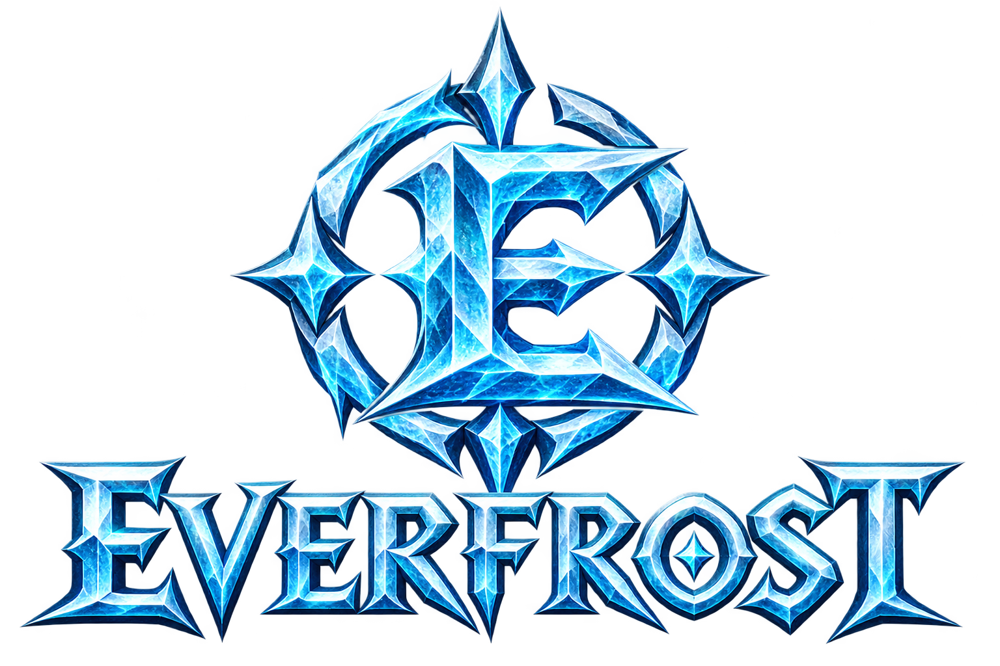
</p>

**Find your class rhythm. Forever.**

Everfrost is a lightweight, standalone Lua addon for **WoW Forever**. It displays a compact, class-aware ability reference for **levels 1–60**, with profiles for all **nine classes and 27 talent trees**. Recommendations are informed by Icy Veins Forever guides and filtered against the spells your character has actually learned. Guide-based gear comparisons add a shiny border to estimated bag upgrades and highlight Need or Greed on the standard loot-roll window.

**Built with new players in mind.** Everfrost grew out of playing alongside brand-new players and people trying WoW for the first time. Its guides focus on **basic rotations and gear stat priorities** for your class and spec, giving you a simple starting point while you learn. The aim is to keep the basics visible and make early decisions about abilities and gear easier to understand.

**Built with AI assistance.** Everfrost was first written with OpenAI Codex and is now developed with Claude Code. Automated tests run against a simulated client; each release is also checked in the game against the [in-game checklist](docs/INGAME_CHECKLIST.md), and the release notes say what was and wasn't seen.

[CurseForge](https://www.curseforge.com/wow/addons/everfrost) · [Download v0.9.0](https://github.com/mckenna654/Everfrost/releases/tag/v0.9.0) · [Report an issue](https://github.com/mckenna654/Everfrost/issues) · [Guide sources](addon/Everfrost/SOURCES.md)

CurseForge targets WoW Forever **1.60.1**. Third-party addon-manager distribution is enabled. New version tags trigger automatic packaging; file processing and moderation can delay availability.

## Project status

| Item | Current status |
| --- | --- |
| Addon version | **0.9.0** |
| Supported levels | **1–60** |
| Class coverage | Nine classes, 27 talent trees, and nine general levelling profiles |
| Target interface | `16001` — compatibility with the actual Forever client remains unverified |
| Runtime | Lua 5.1-compatible syntax; no third-party addon libraries required |
| Validation | Lua syntax checks, a luacheck globals check and mocked-client regression tests, run automatically on GitHub Actions |
| In-game verification | Selected gear/glow/settings behavior confirmed by user in earlier versions. On 24 November 2026 the 0.9.0 settings, HUD (out of combat), gear tooltips and talent tooltips were seen rendering in game; HUD behaviour in combat, the enemy estimate and controller layouts are still untested |

Everfrost is an independent project. It is not an official Icy Veins, Blizzard, or OpenAI addon and is not affiliated with or endorsed by those organizations.

## Screenshots

Captured in WoW Forever on 24 November 2026 with version 0.9.0, on a level-35 Protection Paladin.

**Rotation HUD:** the NOW icon, upcoming guide priorities and the tank defensive row. Hovering an icon shows the spell and Everfrost's note on why it's there.

| Rotation HUD | HUD hover guidance |
| --- | --- |
| 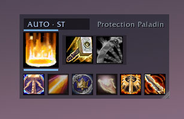 | 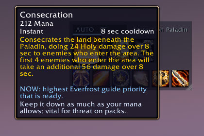 |

**Gear upgrades:** the tooltip names a clear upgrade and says why, or says when an item suits another tree of your class better.

| Clear upgrade | Better for another tree |
| --- | --- |
| 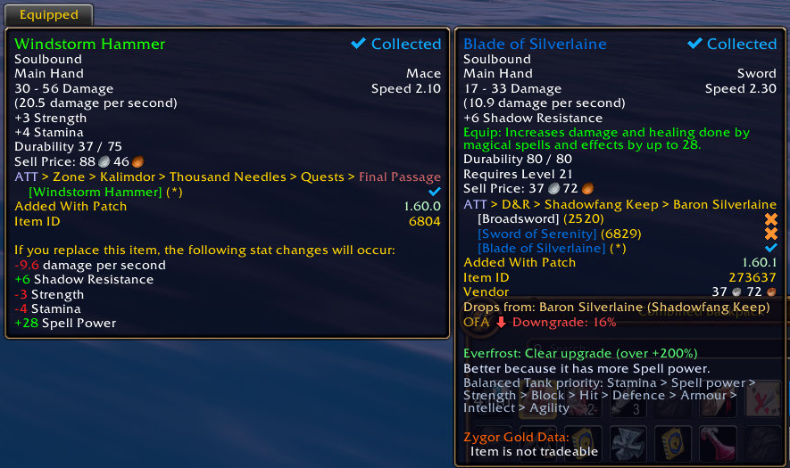 | 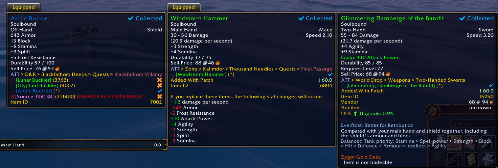 |

**Talent build:** each talent's tooltip shows where the Icy Veins levelling build puts its points.

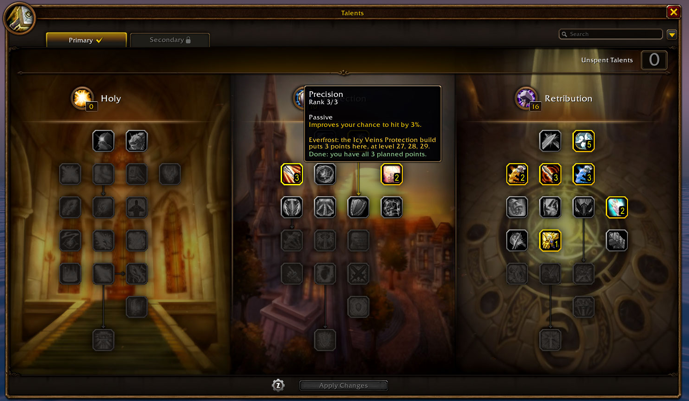

**Settings** (`/everfrost`):

| Rotation | HUD | Controller |
| --- | --- | --- |
| 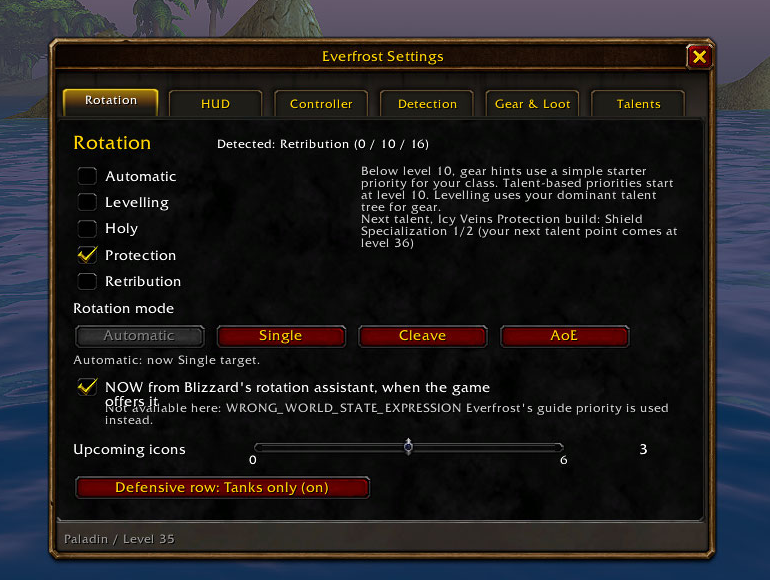 | 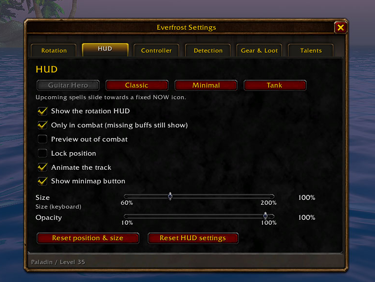 | 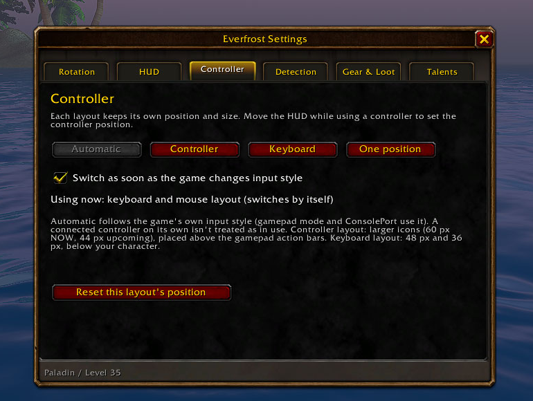 |

| Detection | Gear & Loot | Talents |
| --- | --- | --- |
| 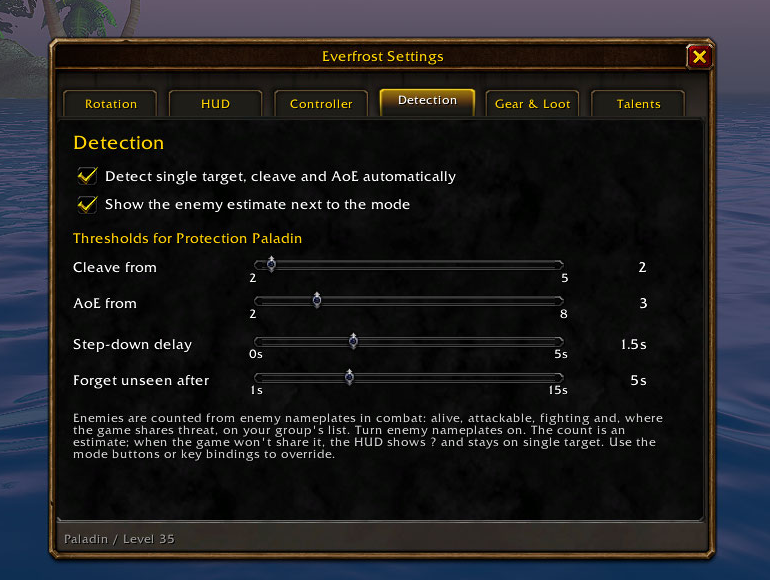 | 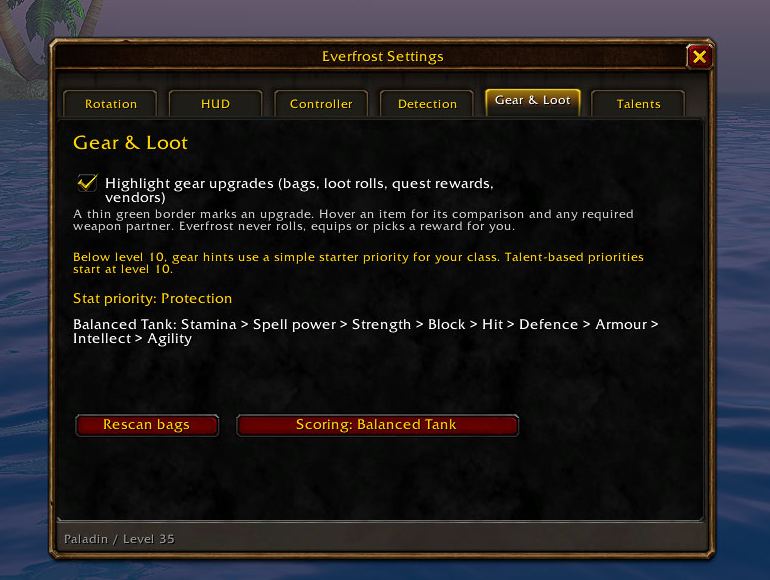 | 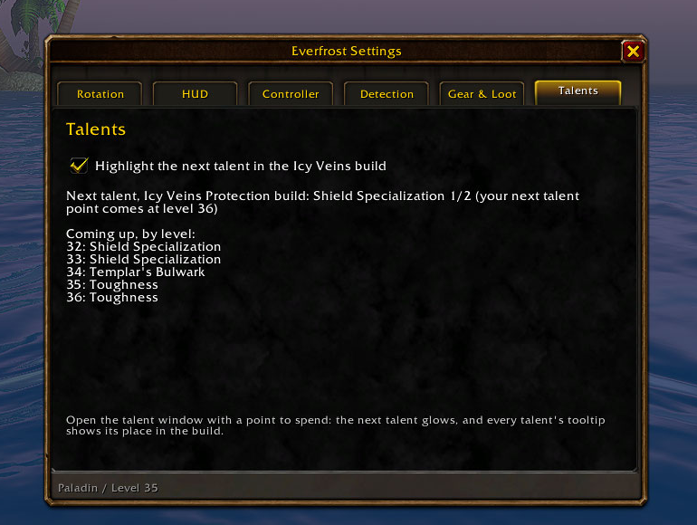 |

Open any screenshot for its full-size view. Player names have been cropped out.

## What Everfrost does

- Detects your class, level, and dominant talent tree, with a manual specialisation override.
- Recommends only abilities you've learned, using the trained ranks found in your spellbook.
- Provides concise hover guidance for openers, maintenance effects, fillers, and situational abilities.
- Shows a rotation HUD: a fixed NOW icon (from Blizzard's rotation assistant where available), upcoming priorities sliding towards it, and a separate defensive and utility row for tanks.
- Switches between single target, cleave and AoE automatically from an enemy estimate, with a manual override; offers healing and damage views and Feral and Survival role controls.
- Moves and resizes the HUD automatically for controller or keyboard and mouse, with separate saved positions.
- Shows native cooldown sweeps when the client supports cooldown duration objects.
- Marks estimated bag upgrades with a thin green border and how much better they are as a green percentage (fainter for minor upgrades). Scores use numeric stat weights for your spec: measured by the [wowsims Forever simulator](https://wowsims.com/forever) for 17 of the 27 talent trees, and an estimate from the guide's stat order for the rest. Tanks and Feral can choose a scoring focus such as Balanced Tank, Tank Survivability, Tank Threat or Solo Levelling, and you can change any weight yourself.
- Highlights Need for estimated loot upgrades and Greed for known non-upgrades or class-irrelevant loot; you make the roll.
- Adds a clear UPGRADE label, score comparisons and stat priorities to item-button hover tooltips.
- Labels the best quest reward **Recommended**, says when rewards are close or when another role would pick differently ("Best for tanking"), and otherwise marks the best sell value. You still pick the reward yourself.
- Highlights upgrades on the merchant's current page once you can afford them. Tooltips say when you can't yet.
- Explains upgrades in plain words, for example "Better because it has more Strength".
- Shows empty armour slot counts in settings, and a reminder on the HUD when no weapon is equipped.
- Provides native-style settings (Rotation, HUD, Controller, Detection, Gear & Loot, Talents), plus a draggable minimap button.
- Saves HUD positions, mode and specialisation per character; size, opacity, lock, minimap button, gear highlights and HUD layout choices carry over to new characters.
- Has key bindings (Key Bindings > AddOns > Everfrost) to show or hide the HUD and to change rotation mode, and a corner you can drag to resize it.
- Shows the Icy Veins levelling talent build in the talent window: a glow on the talent to take next, and each talent's planned points and levels in its tooltip.
- Counts armour for every spec, and plate or mail from level 40.
- Refreshes spellbook and talent metadata outside combat, deferring changes until combat ends when necessary.

### The rotation HUD

A compact HUD sits below your character (or above the gamepad action bars when you play with a controller). It has no window around it, only icons and one thin line of text:

- **NOW**: the large icon between two thin blue bars is the spell to press. When the game offers it, this comes from Blizzard's own rotation assistant, which can see cooldowns, resources and procs that addons can't read in combat. Otherwise it is the highest-priority guide spell that the game says is ready. It pulses gently when it changes.
- **Upcoming**: up to six smaller icons (three by default) in the guide's priority order. In the Guitar Hero layout they slide towards NOW. They are a priority list, not a promise about your next casts.
- **Defensive and utility row** (on by default for tanks): interrupts, taunts and defensive cooldowns you've learned, with cooldown sweeps. Everfrost can't see how much danger you're in, so these show as available, never as urgent; the big ones (Divine Shield, Shield Wall) are dimmed and marked situational.
- **Missing buffs**: out of combat, a buff or seal the game says is missing (Righteous Fury, Seal of Fury, Battle Shout, a stance) shows as a reminder.
- **Mode**: `AUTO · ST ~2` on the header line. Click it to step through **AUTO, ST, CLV, AOE**; right-click returns to AUTO.

Four layouts share the same recommendations: **Guitar Hero** (default), **Classic** (a plain row), **Minimal** (one large and two small icons) and **Tank** (the track plus the defensive row). The HUD shows in combat only by default; turn on **Preview** in settings to place it.

### Automatic single target, cleave and AoE

In AUTO mode Everfrost estimates how many enemies are engaged from **enemy nameplates** in combat: alive, attackable, in combat, not pets or totems and, where the game shares threat, on your threat list (or your group's, in a party). With nameplates off, your target alone counts. It switches to **Cleave** at 2 and **AoE** at 3 by default (adjustable per spec), steps up at once and steps back down only after the lower count has held for 1.5 seconds. An enemy that walks out of view is remembered for 5 seconds; a dead one is dropped at once.

The count is an estimate and is shown as one (`~3`). Forever hides the combat log from addons, so nothing else is available. When the game won't share enough to count, the HUD shows `?` and stays on single target. Cleave uses the single-target list plus the AoE spells that pay off against two enemies (Cleave, Multi-Shot, Swipe, Consecration, Chain Lightning and similar); a spec with none of them uses its single-target list. A manual mode stays until you change it.

### Controller and keyboard layouts

Everfrost follows the game's own input style: switch to a controller (native gamepad mode, Steam Deck, or ConsolePort, which uses the same game setting) and the HUD moves to its controller position with larger icons (60 px NOW, 44 px upcoming, against 48 and 36 px with keyboard and mouse), without a reload. A connected controller alone doesn't count; the game has to say it's in use, and a 0.75-second pause stops flicker when you touch the mouse. Each layout keeps its own position and size: move or resize the HUD while using that layout. Settings can force one layout or use a single position for both.

Everfrost never casts, rolls, equips or clicks anything for you.

## Gear upgrades and loot rolls

Gear hints are enabled by default. Every mark comes from one scoring engine, which sorts each item into a clear upgrade (10% or more), a minor upgrade (3–10%), a sidegrade, better for another focus or tree of your class, not usable, or a downgrade. Open the standard bags: a thin green border and a green percentage (such as **+48%**) mark a clear upgrade, a fainter border and percentage a minor upgrade, and sidegrades and downgrades get no mark. An item for an empty slot says **NEW**. Armour pieces with more armour and no loss of useful stats also count, even if they have no other stats. Hover the item for a clear **UPGRADE** label and the score change and the detected specialisation's priorities. Rings and trinkets replace the weaker of the two you wear, and the tooltip says which. A two-hander is always compared with your main hand and off-hand together, so a shield's armour, block and stats count: a tank never sees a two-hander as an upgrade just for its weapon damage. Procs, Use effects and unread Equip lines are named in the tooltip but never given a made-up score.

**Complete weapon comparisons:** when replacing an equipped two-hander, Everfrost searches your carried bags for a usable one-hand/off-hand pair. Each candidate is compared together with its best valid partner; an estimated pair upgrade can highlight both bag items. The tooltip names the partner and makes clear that you must equip both. Loot candidates use partners you already carry. Shields, held off-hands and learned Dual Wield are supported; an incomplete or unresolved pair stays unscored.

On standard dungeon or raid group-loot windows, a faint ring marks **Need** for an upgrade (pulsing slowly only for a clear one) and a faint grey ring marks **Greed** for a downgrade or an item you can't use. Sidegrades get no mark. Disabled roll options are respected. You still choose and click the roll, following your group's loot rules. Missing or restricted data produces no highlight.

**Where the weights come from.** Seventeen talent trees use the stat weights the open-source [wowsims Forever simulator](https://wowsims.com/forever) publishes with its presets (read on November 25, 2026): Arms, Fury and Protection Warrior, all three Rogue and Hunter trees, Retribution, all three Priest trees, Balance and Feral (Cat and Bear), Elemental and Enhancement. They are level 60 values measured against a raid boss, so treat them as a guide while levelling; Everfrost adds a small allowance for Stamina and armour, which a damage simulator values at nothing. No simulator publishes weights yet for Mage, Warlock, Holy and Protection Paladin, Restoration Druid or Restoration Shaman, so those keep an Everfrost estimate built from the stat order of their Icy Veins Forever guide (checked **November 11, 2026**). **Settings → Gear & Loot → Stat weights** (or `/everfrost weights`) shows every number, says where it came from, and lets you type your own; the changes save per character and per spec, and **Reset to defaults** undoes them. Scores are estimates, not guaranteed best-in-slot results. Weapon speed, dual-wield damage penalties, procs, set bonuses, on-use effects, sockets, enchants, professions and hit caps can change the real result. See [gear scoring and all 27 priorities](docs/GEAR.md) for the formula and limits.

Metadata refreshes outside combat; changes and new loot during combat wait until combat ends. The feature supports the standard bag and group-loot frames, including modern combined bags and classic bags where those hooks exist. Custom inventory/loot replacements are not integrated. **Below level 10, gear hints use a simple starter priority for your class**, because there is usually no talent tree to read yet. These lists are Everfrost estimates, not guide rankings. Talent-based priorities start at level 10. This applies even when a spec is selected manually. Levelling uses the active talent group's dominant tree for gear, while retaining the general spell guide. All three point counts must be available; ties, unspent talents and unavailable data remain unscored. From level 10, explicit spec selections override detection. Gear comparisons cover levels 10–30; a healer's DAMAGE view keeps the healer gear profile, and Survival uses ranged priorities until its melee requirements are met or RANGED is selected.

Use `/everfrost gear` to print your current stat order, `/everfrost gear off` to disable highlights, and `/everfrost gear on` to enable them again. `/everfrost refresh` requests a new comparison outside combat. Hiding the rotation HUD leaves gear hints enabled unless you switch them off separately.

## Installation

1. Download **`Everfrost-0.9.0.zip`** from the [v0.9.0 release](https://github.com/mckenna654/Everfrost/releases/tag/v0.9.0).
2. Exit WoW Forever.
3. Extract the archive's `Everfrost` folder into your Forever client's `Interface/AddOns` directory.
4. Confirm the resulting path is `Interface/AddOns/Everfrost/Everfrost.toc`.
5. Enable **Everfrost** in the AddOns list and log in. type `/everfrost` for settings or `/everfrost preview` to see the rotation HUD out of combat.

Use the release asset for installation. GitHub's automatically generated source archives contain the development project; when using those, copy only `addon/Everfrost` into `Interface/AddOns`.

### Upgrading from earlier names

Earlier iterations were named **ForeverRetHelper** and **ForeverGuide**. Remove those old addon folders before enabling Everfrost to avoid duplicate panels. The current addon uses `Everfrost`, `EverfrostDB`, and `/everfrost`; settings from the previous identities are not migrated. `/fguide` and `/frh` remain command aliases.

## Using the HUD

Click the spec name on the right of the HUD's header line to open **Choose a Spec**. Select **Automatic**, **Levelling**, or one of your class's three specialisations. Automatic shows the detected tree. Levelling keeps the general spell guide and uses the tree with the most spent talent points for gear from level 10. Your choice is saved per character. Changes during combat apply after combat ends.

Hover a spell (out of combat) for its tooltip and the guide's note. In combat the icons let clicks through to the world. Unlock the HUD to drag it and to get the resize corner; lock it with `/everfrost lock`. Right-click the HUD for settings.

| Control | Behavior |
| --- | --- |
| **AUTO / ST / CLV / AOE** | Rotation mode: automatic, or a manual single-target, cleave or AoE mode that stays until changed |
| **HEAL / DAMAGE** | Changes the view for healing specialisations; healing is the default |
| **CAT / BEAR** | Selects the Feral view; before Cat Form is learned, Bear or caster guidance is used as available |
| **RANGED / MELEE** | Changes the Survival view; melee requires level 30 and learned Strider Kick |

Key Bindings > AddOns > Everfrost has keys to show or hide the HUD, step through the modes, and pick AUTO, ST, CLV or AOE directly.

Survival defaults to the ranged approach before its melee requirements are met. At level 30 with Strider Kick learned, it defaults to melee unless you explicitly select ranged. Its melee guidance also assumes the supporting talents described in the linked guide.

### Settings window

Type **`/everfrost`**, `/everfrost settings`, or `/everfrost config` to open the settings window. You can also left-click the Everfrost minimap button, or go to **Escape → Options → AddOns → Everfrost** and click **Open Everfrost settings**. Older clients use the Interface → AddOns category where that API is available.

- **Rotation:** choose Automatic, Levelling or a specialisation; the rotation mode; whether NOW comes from Blizzard's rotation assistant; how many upcoming icons; the defensive row (tanks only, on or off); any role view.
- **HUD:** layout, show/hide, combat only, preview, lock, animation, minimap button, size and opacity, reset position and size, and reset all HUD settings.
- **Controller:** automatic, controller, keyboard or one shared position; automatic switching on or off; reset this layout's position.
- **Detection:** automatic detection and the enemy estimate on or off; the cleave and AoE thresholds for the current spec; how long before stepping down and how long an unseen enemy is remembered.
- **Gear & Loot:** upgrade highlights, the current stat order, where its weights come from, the scoring focus, and a fresh bag scan outside combat. **Stat weights** opens a page listing the value of each stat for your spec, which you can change or reset.
- **Talents:** talent highlights on or off, the next talent and the next few by level.

Settings apply immediately and save per character. While the window is open, the HUD shows so you can see changes (unless you've hidden it). Existing guide changes during combat still apply after combat ends; open the settings window outside combat. Escape or the close button dismisses the window. Drag its header to move it.

The settings window uses the game's native window border, inset, top tabs, font styles and size slider in a compact layout. Priority text aligns directly under its heading; the level-10 note remains visible. Use the slider for HUD sizes from 60% to 200%.

Drag the minimap button around the minimap to reposition it; right-click it to show/hide the rotation HUD. `/everfrost minimap on` restores a hidden button, and `/everfrost minimap off` hides it. These UI paths still require verification in the Forever client.

### Specialisation detection

Automatic detection selects the talent tree with the most points. A tie displays **HYBRID** and uses the general levelling profile; no spent points displays **UNSPENT**. If talent-point APIs are unavailable, the client specialisation API is used when available.

Everfrost reads Forever's active trait config and group-currency totals, using the same spent-point field as the native talent window. Specialisation settings shows the detected split, for example **Elemental (9 / 0 / 0)**, and `/everfrost status` includes the cached totals and detection source. Unavailable or uncommitted talent data stays unavailable until an outside-combat refresh.

Use `/everfrost spec 1`, `/everfrost spec 2`, or `/everfrost spec 3` to select a tree in talent-window order. Use `/everfrost spec auto` to restore automatic detection.

### Class coverage

| Class | Talent trees |
| --- | --- |
| Druid | Balance, Feral, Restoration |
| Hunter | Beast Mastery, Marksmanship, Survival |
| Mage | Arcane, Fire, Frost |
| Paladin | Holy, Protection, Retribution |
| Priest | Discipline, Holy, Shadow |
| Rogue | Assassination, Combat, Subtlety |
| Shaman | Elemental, Enhancement, Restoration |
| Warlock | Affliction, Demonology, Destruction |
| Warrior | Arms, Fury, Protection |

Several specialisations share early-level priorities until their distinct abilities become available. Reaching a level does not itself add an ability to the HUD: it must also be learned. Characters above level 30 receive a scope notice.

## Commands

| Command | Action |
| --- | --- |
| `/everfrost`, `/everfrost settings`, or `/everfrost config` | Open settings |
| `/everfrost show` / `/everfrost hide` | Show or hide the rotation HUD |
| `/everfrost mode auto`, `st`, `cleave` or `aoe` | Set the rotation mode (`/everfrost single` and `/everfrost aoe` still work) |
| `/everfrost layout track`, `classic`, `minimal` or `tank` | Choose the HUD layout |
| `/everfrost input auto`, `pad`, `kbm` or `custom` | Choose the controller or keyboard layout, or one position for both |
| `/everfrost upcoming 3` | Number of upcoming icons, `0`–`6` |
| `/everfrost utility auto`, `on` or `off` | Defensive and utility row: tanks only, always, or never |
| `/everfrost preview` | Show the HUD out of combat to place it (again to stop) |
| `/everfrost enemies` | In combat, print the enemy estimate and mode |
| `/everfrost heal` / `/everfrost damage` | Set the healing-specialisation view |
| `/everfrost cat` / `/everfrost bear` | Set the Feral view |
| `/everfrost ranged` / `/everfrost melee` | Set the Survival view, subject to melee requirements |
| `/everfrost spec levelling` / `/everfrost spec 0` | Select the general levelling guide |
| `/everfrost spec auto` | Restore automatic talent-tree detection |
| `/everfrost spec 1`, `2`, or `3` | Select a talent tree manually |
| `/everfrost lock` / `/everfrost unlock` | Lock or unlock HUD dragging |
| `/everfrost scale 1.2` | Set the current layout's size; accepted range is `0.6`–`2` |
| `/everfrost opacity 60` | Set HUD opacity to 60%; accepted range is `10`–`100` |
| `/everfrost reset` | Reset the current layout's position and size, and show the HUD |
| `/everfrost gear` | Show active gear stat priorities |
| `/everfrost gear on` / `/everfrost gear off` | Enable or disable gear and loot highlights |
| `/everfrost weights` / `/everfrost weights reset` | Open the stat weights page, or put this spec's weights back to their defaults |
| `/everfrost minimap on` / `/everfrost minimap off` | Show or hide the minimap settings button |
| `/everfrost refresh` | Refresh cached metadata outside combat |
| `/everfrost source` | Print the current profile's guide URL |
| `/everfrost status` | Print class, tree, level, detection status, cached talent totals/source, and any scan error |
| `/everfrost help` | Display command help |

`reset` resets the current layout's position and size and shows the HUD; it does not clear other preferences. **Reset HUD settings** on the HUD settings page restores every HUD default.

## Development

The source of truth is **`addon/Everfrost`**. The addon runs independently of Node.js; Node dependencies are used only by the development test harness.

### Set up and test

Install Node.js with npm, then run:

```sh
git clone https://github.com/mckenna654/Everfrost.git
cd Everfrost
npm ci
npm test
```

The harness parses all seven Lua files as Lua 5.1 using `luaparse`, then executes regression checks with `fengari`. Coverage includes class/spec profiles, selected level boundaries, learned-rank filtering, talent API variants, combat deferral, role and encounter controls, Survival's level-30 transition, guide-menu selection, settings controls and entry points, modern/legacy settings registration, minimap dragging, all 27 gear profiles, item eligibility, paired slots, async item data, and loot-roll highlights.

These tests simulate client APIs. A passing result does not prove compatibility with the Forever client, correct visual layout, or real secret-value handling.

### Package the addon

The packaging command uses Node.js and works on Windows, macOS and Linux:

```sh
npm run build
```

It creates `dist/Everfrost-0.9.0.zip`, containing only the installable `Everfrost` folder. It does not install the addon or publish a release.

When releasing a new version, update `addon/Everfrost/Everfrost.toc` and `package.json` together, keep lockfile metadata synchronized, run the tests, and verify the archive contents before uploading.

### CurseForge automatic packaging

CurseForge is configured to package tagged commits only. The repository's
`.pkgmeta` selects the installable addon and excludes development files.
An active GitHub push webhook connects this repository to CurseForge. Ordinary
branch commits are excluded by the tag-only setting. The v0.4.2 tagged build
was verified end to end, including ZIP layout and game version.
See [release instructions](docs/RELEASING.md) for version tags and validation.

### Repository layout

```text
addon/Everfrost/
  Everfrost.toc       Addon metadata and Lua load order
  Profiles.lua       Class/spec reference data and row filtering
  Core.lua           Talent detection and learned-spell scanning
  GearProfiles.lua   Guide-based stat orders for all 27 talent trees
  Gear.lua           Item cache, eligibility and equipped-slot comparisons
  GearUI.lua         Bag/loot borders and tooltip hooks
  Settings.lua       Settings window, native settings entry and minimap button
  Main.lua           Panel, event handling, settings controller and commands
  README.md          Packaged user instructions
  SOURCES.md         Guide links and source-review notes
scripts/build.cjs    Cross-platform addon-only ZIP packaging
tests/check.cjs      Syntax and simulated-client regression checks
tests/gear.cjs       Gear scoring, cache and UI regression checks
docs/GEAR.md         Stat audit, scoring formula and limitations
docs/HANDOFF.md      Project history and outstanding in-game checks
docs/INGAME_CHECKLIST.md  What to check in the game before a release
docs/VALIDATION.txt  Recorded simulated-test runs and their limits
AGENTS.md            Project instructions for AI coding agents
```

### Contribution guidelines

Keep the interface compact and preserve learned-spell-aware recommendations, Lua 5.1 compatibility, and the existing addon identifiers. Review current Icy Veins Forever guides before changing rotation content, and retain source links. Cache spellbook and talent metadata outside combat; do not compare or branch on secret combat values. Pass cooldown duration objects directly to native widgets.

Run `npm test` after Lua behavior changes. Include the relevant class, specialisation, level, and learned-spell scenario when describing a fix. Report simulated tests and actual client testing separately.

## Known limitations and troubleshooting

- **Client compatibility is unverified.** The TOC targets interface `16001`; actual API behavior and rendering need in-game checks.
- **English guidance.** Existing spells use localized names where mappings are available. New Forever-specific spell names currently require an English spellbook.
- **Guide content is manually maintained.** Some source pages retain older level-20 wording. The recorded Arcane review used indexed excerpts because the full page was inaccessible.
- **Forever hides combat details from addons.** The combat log, many cooldowns, threat and some unit details can be secret in combat. Everfrost never guesses at a secret value: NOW relies on Blizzard's rotation assistant where it exists, the enemy count is an estimate from nameplates, and defensives are shown as available rather than urgent.
- **Manual combat conditions.** Talent build details, gear, weapon setup, proc conditions, and encounter context must be checked by the player.
- **Spellbook API dependence.** Missing or incomplete client metadata can leave abilities absent from the HUD.

If a learned ability is missing, leave combat and run `/everfrost refresh`. Check that the selected role, encounter mode, specialisation, and level are appropriate. For an issue report, include:

- Addon version and Forever client build.
- Class, level, talent tree, and relevant learned spell/rank.
- Output from `/everfrost status`.
- Expected behavior, observed behavior, and reproduction steps.
- Any Lua error and, for layout issues, a screenshot.

Before treating a build as game-tested, verify login and trained icons, training and respec updates, level thresholds, role/AoE controls, cooldown sweeps, dragging, and persistence after reload or logout. Repeat on another class.

## License

Everfrost is licensed under the [MIT License](LICENSE). The same license is selected on CurseForge.

## Sources and acknowledgments

Gear stat weights for 17 talent trees come from the **[wowsims WoW Forever simulator](https://wowsims.com/forever)** ([source](https://github.com/wowsims/forever), MIT licence); the presets used are listed in [docs/GEAR.md](docs/GEAR.md).

Ability references are concise adaptations of the **Icy Veins WoW Forever PvE guides**. The [source index](addon/Everfrost/SOURCES.md) preserves all 27 guide links, API references, and review notes. Use `/everfrost source` to find the guide associated with the active profile.

Everfrost was first written with **OpenAI Codex** and is now developed with **Claude Code**. See the [development handoff](docs/HANDOFF.md) for the project's evolution from ForeverRetHelper and ForeverGuide to Everfrost v0.4.0.
